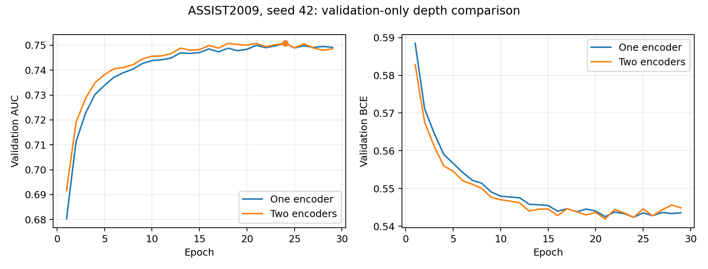

# Completed LightSAKT depth experiment — 25 October 2026

The actual ASSIST2009 seed-42 GPU comparison completed successfully. Both models
trained from fresh initialization, completed 29 epochs, and selected epoch 24 by
validation AUC. The two-layer model did **not improve AUC in this pilot**:
delta = −0.0000126048313747. This is an extremely small difference on one seed,
not evidence of a statistically significant disadvantage. F1 and accuracy were
slightly higher and BCE slightly lower for the two-layer model.

|Selected-checkpoint validation metric|Original one layer|Two layers|Two minus one|
|---|---:|---:|---:|
|AUC|0.750803537111|0.750790932280|−0.000012604831|
|F1, threshold 0.5|0.814805489110|0.816262117682|+0.001456628573|
|Accuracy, threshold 0.5|0.732116841492|0.732845279720|+0.000728438228|
|BCE|0.542363721265|0.542330543346|−0.000033177919|
|Selected epoch|24|24|0|
|Epochs completed before patience stop|29|29|0|
|Run time, seconds|215.2315|231.0228|+15.7913|
|Peak allocated GPU memory, MiB|254.5771|327.8369|+73.2598|
|Peak reserved GPU memory, MiB|368|460|+92|

Run time includes validation, checkpointing and the shared-GPU pacing delay.
The two runs consumed 446.25 seconds in this measured scope, below the 900-second
invocation ceiling. Timing under pacing is not an isolated GPU throughput
benchmark. Allocated/reserved memory is this process's PyTorch allocator usage;
driver/context memory and other users are outside those counters. Both models
stayed well below the unchanged 4 GiB allocator cap.

Both used the exact existing student-disjoint 70/10/20 split, split seed 42,
training seed 42, training-fitted vocabulary, full chronological chunks of length
100, batch 64, d=64, 2 heads, dropout 0.1, Adam lr=0.001/betas=(0.9,0.999)/eps=1e-8,
zero weight decay, float32, disabled AMP/TF32, maximum 50 epochs and validation-AUC
patience 5. The complete training and validation data were retained. Evaluation
pooled all 27,456 validation targets. AUC alone selected checkpoints; F1 and
accuracy used the fixed 0.5 threshold. No test loader, test predictions, test
evaluation or test-based selection was used.

No earlier checkpoint initialized either model. `fresh_start_record.json` records
the absence of prior pilot checkpoints. The immutable configs are under
`experiments/architecture_study/pilot/configs/`; the actual training source commit
is `f46e7d81`. The baseline's entire 29-epoch validation-AUC trajectory exactly
matches its original recorded seed-42 trajectory, including the selected AUC.
The one-layer versus two-layer comparison uses their newly trained validation
metrics, never old test AUC.

The user explicitly authorized a bounded hold release. Existing documented
intentional shared-H100 permission and that new scope are recorded in
`EXECUTION_AUTHORIZATION_20261025.md`. The narrow exception was bound to both
hold-marker hashes, exactly two depth configuration hashes, seed 42 and the
15-minute window. General hold markers stayed byte-identical, so automatic
scheduling/recovery and all other experiments stayed blocked. Execution used
the original project's nonblocking admission lock, a pilot lock and only the
exposed H100 MIG `MIG-d2fcfd79-720e-5218-82c9-0a132be68920`.

The shared safeguards retained a 4 GiB allocator cap, 10 GiB admission free floor,
6 GiB runtime free floor, 4 GiB host RSS cap, 2 GiB host headroom, 0.1-second
inter-batch pause and 30-second step/time-between-batches stop. There were 218
runtime telemetry samples. Minimum observed free GPU memory was 41,371,893,760
bytes; minimum host headroom was 21,069,332,480 bytes. Maximum observed process
peak RSS was 1,573,945,344 bytes. MIG utilization was explicitly unsupported,
not assumed zero; the pre-existing cap/headroom/pacing fallback applied. PID
namespace attribution remains unresolved. No other job was signalled, stopped,
rescheduled or reassigned. A post-exit observation records an unattributed
compute PID and about 5.1 GB device usage, without claiming ownership or that
the GPU became exclusive or idle.

Both `best.pt` and `latest.pt` files were saved for both arms under
`pilot-workspace/checkpoints/<pilot run ID>/`. Latest state includes finite model
and Adam state, complete-epoch history, Python/NumPy/Torch/CUDA RNG, loader RNG,
patience state and source/data/config identities. Epoch CSVs contain validation
AUC, F1, accuracy, BCE, training BCE, runtime, allocated/reserved GPU peaks and
process lifetime peak RSS. Their measured numerical series are in
`baseline_epochs.csv` and `two_layer_linear_epochs.csv`; selected results are in
`selected_validation_results.csv` and `comparison.json`.

An independent fresh CPU process loaded both selected checkpoints and replayed
validation inference. Absolute AUC differences from the saved GPU results were
1.49e-8 and 8.95e-9; F1 and accuracy matched exactly. This verification also
checked finite optimizer state, source/data/split/grant hashes, correct selected
epochs and complete resume-state fields. It performed zero optimizer updates
and no test evaluation. Evidence: `checkpoint_replay_verification.json`;
reproduce with `CUDA_VISIBLE_DEVICES='' python -m scripts.verify_depth_pilot`.
The scoped-release/resource changes passed 36 targeted CPU tests, with the
unavailable real-data test skipped in the isolated checkout. Earlier architecture
and trainer CPU evidence remains preserved.

A persistent recovery archive contains the four new checkpoints, raw run
records/configs and execution controls at
`/workspace/LightSAKT2/backups/architecture_depth_20261025/pilot_checkpoints_and_records.tar.gz`.
All 22 members were read back and checked against SHA256 values. Archive SHA256:
`1899e200690f6897bfe9af27a003a1f91f324b3f48e63c8b09996c8487aca8d6`.
It contains no original dataset/test files. `recovery_archive.json` lists every
member hash. The archive supplements the local ignored weights; a Git commit
alone does not contain the checkpoint binaries.

The 42 previously recorded original content hashes still match, including the
original baseline results, selected checkpoints, split/protocol files, manifest
and hold. The original checkout remains on `research-rebuild`; research changes
and new numerical artifacts are on `research/architecture-variants-20261025`.
See `final_preservation.json`. The executed grant was preserved byte-for-byte for
provenance, and the live grant is now **closed_completed**. The depth execution
scope is exhausted; nothing is queued or waiting to run automatically.

There is no remaining blocker to reporting this completed comparison. The next
recommended experiment is the **prepared one-layer causal softmax variant** on
ASSIST2009, seed 42, with the same optimizer/data/budget and validation selection.
The primary objective is AUC, and this depth pilot supplied no improvement signal
for prioritizing a full three-dataset five-seed depth campaign. If softmax improves
AUC, evaluate that hypothesis across seeds 42,123,2026,3407,7777 and all three
datasets; recency-biased softmax is the subsequent isolated attention comparison.
No additional variant training was launched under the completed depth grant.

