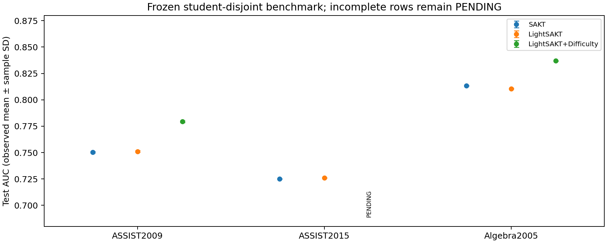
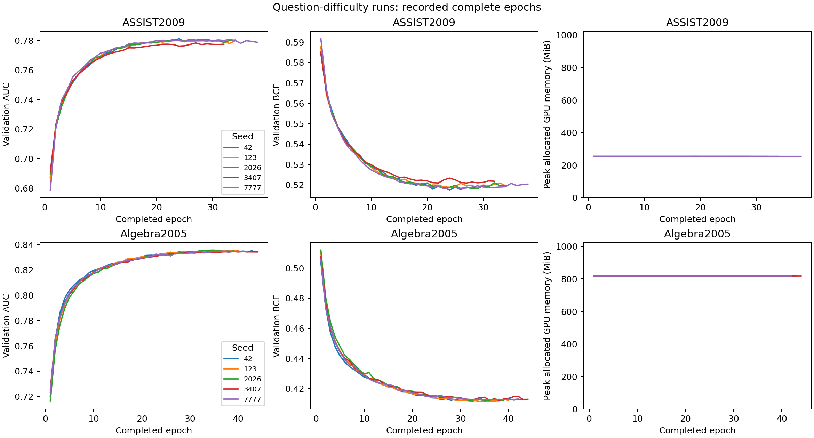

# LightSAKT with question difficulty: verified comparison

Report date: 30 October 2026. Campaign status: **completed**.
Verified model-seed checkpoints: **40 of 45** intended slots
(three datasets, three models, five seeds). Missing measurements are PENDING.

## Research objective and measured findings

Determine whether a training-derived question-difficulty correction improves
LightSAKT relative to the established LightSAKT and SAKT baselines. The reported
ASSIST2009 seed-42 validation AUCs, 0.750803537 and 0.781189972, reproduce from
saved checkpoints within CPU/GPU rounding tolerance. They are validation scores;
held-out test results are reported separately below.

**ASSIST2009: 5/5 paired seeds verified.** Modified minus original LightSAKT: validation AUC +0.030794277, test AUC +0.028302772; positive validation/test seed deltas 5/5 and 5/5. Minimum individual validation/test deltas: +0.030306607 / +0.027579520. Mean test F1 difference +0.005895969; accuracy difference +0.012231074. These are results on one fixed student split, not evidence of general superiority across student populations.

**ASSIST2015: PENDING.** No verified modified-model seed is available. The available source has no independent question identifier.

**Algebra2005: 5/5 paired seeds verified.** Modified minus original LightSAKT: validation AUC +0.027667035, test AUC +0.026281231; positive validation/test seed deltas 5/5 and 5/5. Minimum individual validation/test deltas: +0.027160916 / +0.025798440. Mean test F1 difference +0.006517733; accuracy difference +0.011726940. These are results on one fixed student split, not evidence of general superiority across student populations.

## Main comparison

| Dataset | Model | Validation AUC | Test AUC | Test F1 | Test accuracy | Seeds/status |
|---|---|---|---|---|---|---|
| ASSIST2009 | SAKT | 0.748284 ± 0.000767 | 0.750322 ± 0.000648 | 0.817401 ± 0.000943 | 0.732718 ± 0.000669 | 5/5 COMPLETE |
| ASSIST2009 | LightSAKT | 0.749454 ± 0.001570 | 0.751056 ± 0.000766 | 0.816533 ± 0.001517 | 0.732229 ± 0.000801 | 5/5 COMPLETE |
| ASSIST2009 | LightSAKT+Difficulty | 0.780248 ± 0.001153 | 0.779359 ± 0.000778 | 0.822429 ± 0.000649 | 0.744460 ± 0.000439 | 5/5 COMPLETE |
| ASSIST2015 | SAKT | 0.728970 ± 0.000435 | 0.725180 ± 0.000258 | 0.846664 ± 0.000609 | 0.749418 ± 0.000386 | 5/5 COMPLETE |
| ASSIST2015 | LightSAKT | 0.729922 ± 0.000819 | 0.726088 ± 0.000315 | 0.846282 ± 0.000392 | 0.749526 ± 0.000419 | 5/5 COMPLETE |
| ASSIST2015 | LightSAKT+Difficulty | PENDING | PENDING | PENDING | PENDING | 0/5 PENDING |
| Algebra2005 | SAKT | 0.809999 ± 0.000725 | 0.813373 ± 0.000367 | 0.871012 ± 0.000372 | 0.796382 ± 0.000504 | 5/5 COMPLETE |
| Algebra2005 | LightSAKT | 0.807548 ± 0.000766 | 0.810590 ± 0.000422 | 0.870356 ± 0.000350 | 0.795574 ± 0.000639 | 5/5 COMPLETE |
| Algebra2005 | LightSAKT+Difficulty | 0.835215 ± 0.000498 | 0.836871 ± 0.000217 | 0.876874 ± 0.000771 | 0.807301 ± 0.000642 | 5/5 COMPLETE |

Entries are mean ± **sample standard deviation** (ddof = 1) across the listed
seeds. F1 and accuracy in this table are **test** metrics. A single observation
has no standard deviation; incomplete seed sets remain PENDING. Precision,
recall, BCE and all validation metrics are included in the accompanying
`individual_seed_results.csv` and `summary_results.csv` (also available as JSON).
Threshold metrics use 0.5, without validation- or test-based threshold tuning.

Points show observed means with sample-SD error bars. Missing results have no
plotted estimate. Standalone PDF versions accompany the figures.

## Absolute AUC improvements

Deltas use identical paired seeds. A partial modified seed set is compared only
with those same baseline seeds, rather than a five-seed baseline mean. Positive
values favor the modified model. These are absolute AUC units, not percentages.

| Dataset | Compared with | Paired seeds | Validation AUC Δ | Test AUC Δ | Positive test seeds |
|---|---|---:|---|---|---|
| ASSIST2009 | LightSAKT | 5 | 0.030794 ± 0.000537 | 0.028303 ± 0.000484 | 5/5 |
| ASSIST2009 | SAKT | 5 | 0.031964 ± 0.001220 | 0.029036 ± 0.000567 | 5/5 |
| ASSIST2015 | LightSAKT | 0 | PENDING | PENDING | 0/0 |
| ASSIST2015 | SAKT | 0 | PENDING | PENDING | 0/0 |
| Algebra2005 | LightSAKT | 5 | 0.027667 ± 0.000377 | 0.026281 ± 0.000458 | 5/5 |
| Algebra2005 | SAKT | 5 | 0.025217 ± 0.000731 | 0.023497 ± 0.000424 | 5/5 |

Per-seed deltas and minimum observed effects are preserved in
`paired_seed_auc_deltas.csv` and `absolute_auc_improvements.csv`.

## Original architectures and modification

“Original” in these comparisons means the established **corrected causal
baseline** with the author's original trainable architecture and parameter
shapes. The preserved historical `original_snapshot` had future-attention,
masking and test-selection defects identified in earlier research. Its unverified
historical scores are not included in these results.

LightSAKT has one encoder block. Interaction embedding M(q + K*r) plus learned
position embedding P supplies historical keys and values; E(next_skill) supplies
queries. Q/K/V/output projections have biases. Multihead normalized linear
attention uses ELU(x) + 1, includes exactly valid positions j <= t in both its
numerator and denominator, and adds epsilon 1e-8. Its first residual is
LayerNorm(Dropout(attention) + M + P + E). The feed-forward network is
*d → floor(d/2) → d*, with ReLU and dropout, followed by a second residual
LayerNorm, a linear prediction head and sigmoid. SAKT uses its native one-block
causal multihead softmax attention and *d → d → d* feed-forward network.

Modified LightSAKT preserves that encoder and adds one zero-initialized learned
scalar alpha to the prediction logit:

`prediction = sigmoid(original_logit + alpha * difficulty)`

The feature contains fitted per-question statistics. Thus one additional neural
parameter does **not** imply just one additional statistical degree of freedom.
Counts of fitted question/skill aggregates and unseen-question rates are retained
in `real_data_leakage_audit.json`; these aggregates are additional model inputs
and are not included in the neural parameter count.
No depth, attention, gating or other architecture changes were introduced here.

## Difficulty feature and leakage checks

With smoothing fixed at 10 before the original pilot:

- Skill rate = (skill successes + 1) / (skill observations + 2).
- Question rate = (question successes + 10 * skill rate) / (question observations + 10).
- Difficulty = logit(question rate) − logit(skill rate).

For a **training** example, all responses from that entire student are excluded
from both estimates, including its current and future responses. This prevents
self-label encoding even when a question is rare. Validation and test estimates
use training students' labels only. The held-out transformation accepts question
and skill metadata without the query outcome. Unseen questions fall back to the
skill rate, giving a zero correction; rates are smoothed and finite.

CPU tests cover causality, padding, gradients, zero-initialization equivalence,
feature/target alignment, numerical stability and integration with the original
loss/reporting hook. Real-data perturbation audits on ASSIST2009 and Algebra2005
verify validation-label invariance and entire-own-student-label invariance, with
an other-student perturbation as a responsive positive control. Frozen validation
and test sidecars are independently reproduced from training labels only.
See `cpu_tests.xml`, `real_data_leakage_audit.json` and `checkpoint_state_audit.json`.

ASSIST2009 uses raw `problem_id`. Its original training/validation feature file
was numerically reproduced and reused byte-for-byte. Algebra2005 uses the explicit
known target tutor-step identity `(Problem Name, Step Name)`. Every retained row
was aligned against original source-row index, student, transaction time and
skill. No outcome, hint, response duration or post-response timing field defines
item identity. No interaction was dropped or reordered for this modification.
The [official KDD Cup data format](https://kdd.org/kdd-cup/view/kdd-cup-2010-student-performance-evaluation/Data)
defines a step by this same problem-name/step-name pair and retains those fields
in test records while withholding correctness, hints and response timing fields.
This supports their use as known benchmark metadata. Predictions are conditional
on the target step identity, rather than forecasting which step a student chooses.

**ASSIST2015 is blocked:** the available raw file contains only `user_id`,
`log_id`, `sequence_id`, `correct`; `sequence_id` already serves as skill identity.
There is no independent question identifier. Reusing skills as questions would
change the feature definition. No substitute feature or alternative release was
silently introduced, and no modified ASSIST2015 scores are reported.

**Temporal scope:** estimates fit the complete training corpus under the fixed
retrospective student-disjoint protocol. An earlier audit found later-order
training observations for 95.045% of ASSIST2009 validation attempts. This is
permitted offline fitting, but it does not demonstrate forward-time deployment
performance. A chronological evaluation would require a separately frozen
protocol. During held-out KT evaluation, earlier responses from the same held-out
student form causal history as in the original baseline; future held-out responses
do not enter the prediction or fitted difficulty feature.

## Datasets and partitions

| Dataset | Interactions train / validation / test | Students train / validation / test | Skills (incl. UNK) | Sequence length |
|---|---|---|---:|---:|
| ASSIST2009 | 198942 / 27871 / 47777 | 2905 / 415 / 831 | 137 | 100 |
| ASSIST2015 | 477840 / 68949 / 137012 | 13888 / 1984 / 3968 | 101 | 100 |
| Algebra2005 | 398886 / 94319 / 113820 | 401 / 57 / 116 | 388 | 200 |

All models share the original student-disjoint 70/10/20 partition with split seed
42. Vocabulary is fitted on training students only, with UNK 0. All n−1
next-response targets per student are retained using length-L chunks with one
boundary interaction of overlap; context resets at chunk boundaries. Dataset
variants, input semantics and raw/processed/split SHA256 fingerprints are recorded
in `dataset_metadata.json`. These local releases should not be conflated with
other published variants. Existing cleaning excludes nonbinary ASSIST2015 rows
and Algebra rows without KC; preprocessing was not changed by this experiment.
ASSIST2009 simultaneous skill tags are collapsed into sorted composite skill-name
strings. ASSIST2015 uses the skill-builder `sequence_id`. Algebra2005 uses the
full `KC(Default)` composite string as one skill and starts from the original
training subset, which is then partitioned by student here. Its reported test
split is this local held-out student partition, not the official challenge test.

## Matched training and selection protocol

| Dataset | Model | Embedding | Heads | Dropout | Learning rate | Parameters |
|---|---|---:|---:|---:|---:|---:|
| ASSIST2009 | SAKT | 64 | 4 | 0.2 | 0.0005 | 57985 |
| ASSIST2009 | LightSAKT | 64 | 2 | 0.1 | 0.001 | 53857 |
| ASSIST2009 | LightSAKT+Difficulty | 64 | 2 | 0.1 | 0.001 | 53858 |
| ASSIST2015 | SAKT | 128 | 4 | 0.2 | 0.0005 | 151297 |
| ASSIST2015 | LightSAKT | 128 | 4 | 0.1 | 0.0005 | 134849 |
| Algebra2005 | SAKT | 128 | 2 | 0.2 | 0.0005 | 274305 |
| Algebra2005 | LightSAKT | 128 | 4 | 0.2 | 0.001 | 257857 |
| Algebra2005 | LightSAKT+Difficulty | 128 | 4 | 0.2 | 0.001 | 257858 |

All runs use masked BCE, globally pooled metrics, float32, no AMP or TF32,
Adam with betas (0.9, 0.999), epsilon 1e-8 and zero weight decay, batch size 64,
at most 50 epochs, and patience 5. Strict improvement in **validation AUC** selects
the best checkpoint; test results never select checkpoints or settings.
Training seeds are 42, 123, 2026, 3407 and 7777.

Original SAKT and LightSAKT independently selected their settings using the same
36-point validation grid. Thus selected heads, dropout and learning rate can
differ between models. Modified LightSAKT inherits the original LightSAKT settings
for each dataset without a new search. Full configurations and provenance are in
`training_configurations.json` and `experiment_provenance.json`.

The modified model receives richer item information than the skill-only baselines.
Any improvement supports this feature and representation change; it does not
isolate attention-kernel superiority. A previously prepared feature-matched SAKT
augmentation control has not been executed in this three-model campaign.
Validation was reused during earlier architecture diagnosis and selection; this
exposure is disclosed. No frozen configuration changed after test release.

## Execution, checkpoint verification and reproducibility

Thirty existing baseline seeds and the completed ASSIST2009 difficulty seed 42
were reused. Baselines were not retrained. This request explicitly authorizes
held-out scoring of frozen validation-selected checkpoints, superseding the prior
test-locked development scope. Nine missing runs (four ASSIST2009 and five
Algebra2005) were frozen in commit `a37b17ed` before any new modified-model test
scoring. No feature-matched SAKT training or new architecture was launched.

The original difficulty pilot stopped after epoch 18. The earlier audited exact
continuation resumed epochs 19–29 from its saved optimizer/RNG/data-order state,
selected epoch 24 and completed early stopping. That completion, including the
preserved pre-resume checkpoint archive, is documented in
`reports/architecture_study/question_completion_20261029/`. Its best checkpoint
was reused here; the 0.7812 headline is not an incomplete-run estimate.

Every reported checkpoint is checked against its SHA256, configuration, dataset
and split fingerprints, parameter count and validation-selected epoch, then
independently replayed on CPU validation and test. Earlier GPU scores must agree
within AUC/BCE 2e-6 and accuracy/F1 1e-4; differences and raw scores are retained in
`replays/*.json`. CPU inference uses batch size 8 and performs no optimizer update.
Precision and recall are measured directly. Local ignored prediction arrays have
recorded hashes. An independent check compares targets with every original
student's labels[1:] in exact order, computes AUC using tied-rank Mann–Whitney
statistics, and recomputes classification scores from manual confusion counts
and BCE from probabilities. See `masking_and_metrics_audit.json` for the final
verification status and numerical differences. Completed difficulty checkpoints also retain finite optimizer,
Python/NumPy/Torch/CUDA RNG and data-loader state. The saved shuffle state is
checked against the exact seeded epoch stream; Adam counters match batch counts.
Epoch-wise validation and resource metrics are in `difficulty_epoch_results.csv`.

GPU work uses only the previously permitted shared MIG allocation. Each run has
a 4 GiB allocator cap and a 900-second execution window, with admission free memory
10 GiB, runtime free memory 6 GiB, host headroom 2 GiB, worker RSS ceiling 4 GiB,
0.1-second batch pacing and a 30-second maximum step time. The nine-window ceiling
is 8,100 GPU seconds. An unsafe stop halts the campaign without automatic retry.
Owned worker identity and resource samples are logged; unrelated GPU owners are
not assumed to belong to this project and no peer workload is modified.

Training times include their recorded execution environment. New guarded/paced
runs and historical unpaced baseline timings are **not** controlled speed
comparisons. Existing checkpoints, source, raw records, splits and hold markers
are fingerprinted and preserved. Execution status and resources are in
`campaign_status.json`, `campaign_training.log` and `campaign_resource_samples.jsonl`.

The verified resource snapshot covers 9 completed new runs (campaign: completed). Admitted GPU-window wall time: 3850.931 seconds of the 8,100-second ceiling; summed native training time: 3832.884 seconds. Maximum allocated GPU memory: 817.967 MiB; maximum worker RSS: 1.584 GiB. Minimum shared GPU free memory: 18.818 GiB; minimum host headroom: 32.568 GiB. Sampled runtime-floor/RSS breaches: 0. These are allocation-window wall times including pacing, not kernel-active profiling or exclusive GPU time.

## Individual seed results

| Dataset | Model | Seed | Validation AUC | Test AUC | Test F1 | Test accuracy | Best / completed epoch |
|---|---|---:|---:|---:|---:|---:|---|
| ASSIST2009 | SAKT | 42 | 0.749442606 | 0.749198555 | 0.816955628 | 0.732607677 | 36 / 41 |
| ASSIST2009 | SAKT | 123 | 0.748615381 | 0.750691833 | 0.817147016 | 0.732415967 | 31 / 36 |
| ASSIST2009 | SAKT | 2026 | 0.747664391 | 0.750761905 | 0.818918410 | 0.733885741 | 29 / 34 |
| ASSIST2009 | SAKT | 3407 | 0.748107389 | 0.750347336 | 0.816418412 | 0.732479870 | 27 / 32 |
| ASSIST2009 | SAKT | 7777 | 0.747588929 | 0.750612312 | 0.817564430 | 0.732202957 | 37 / 42 |
| ASSIST2009 | LightSAKT | 42 | 0.750803537 | 0.750508348 | 0.814765947 | 0.730860989 | 24 / 29 |
| ASSIST2009 | LightSAKT | 123 | 0.749794733 | 0.751549123 | 0.817761278 | 0.732309462 | 29 / 34 |
| ASSIST2009 | LightSAKT | 2026 | 0.749631395 | 0.752093588 | 0.817087741 | 0.732586376 | 26 / 31 |
| ASSIST2009 | LightSAKT | 3407 | 0.746766658 | 0.750216352 | 0.817985162 | 0.732948494 | 21 / 26 |
| ASSIST2009 | LightSAKT | 7777 | 0.750272203 | 0.750912266 | 0.815064560 | 0.732437268 | 20 / 25 |
| ASSIST2009 | LightSAKT+Difficulty | 42 | 0.781189972 | 0.778555249 | 0.821588716 | 0.744046351 | 24 / 29 |
| ASSIST2009 | LightSAKT+Difficulty | 123 | 0.780341551 | 0.779128643 | 0.823155478 | 0.744003749 | 29 / 34 |
| ASSIST2009 | LightSAKT+Difficulty | 2026 | 0.780865054 | 0.780599489 | 0.822951255 | 0.744451071 | 29 / 34 |
| ASSIST2009 | LightSAKT+Difficulty | 3407 | 0.778264523 | 0.778969884 | 0.822007820 | 0.744962297 | 27 / 32 |
| ASSIST2009 | LightSAKT+Difficulty | 7777 | 0.780578811 | 0.779540275 | 0.822441266 | 0.744834491 | 33 / 38 |
| ASSIST2015 | SAKT | 42 | 0.729264682 | 0.725195505 | 0.846851311 | 0.749135624 | 13 / 18 |
| ASSIST2015 | SAKT | 123 | 0.728275257 | 0.725120267 | 0.847558993 | 0.749789543 | 11 / 16 |
| ASSIST2015 | SAKT | 2026 | 0.729054699 | 0.725520410 | 0.846464376 | 0.749864706 | 12 / 17 |
| ASSIST2015 | SAKT | 3407 | 0.728871781 | 0.724804604 | 0.846553990 | 0.749015363 | 10 / 15 |
| ASSIST2015 | SAKT | 7777 | 0.729382553 | 0.725258151 | 0.845893702 | 0.749285951 | 10 / 15 |
| ASSIST2015 | LightSAKT | 42 | 0.730065294 | 0.725976675 | 0.845896512 | 0.749669282 | 18 / 23 |
| ASSIST2015 | LightSAKT | 123 | 0.730525180 | 0.725897266 | 0.846839378 | 0.750045098 | 11 / 16 |
| ASSIST2015 | LightSAKT | 2026 | 0.730859149 | 0.726010353 | 0.846253075 | 0.749165690 | 12 / 17 |
| ASSIST2015 | LightSAKT | 3407 | 0.729101602 | 0.726645479 | 0.846480834 | 0.749721897 | 13 / 18 |
| ASSIST2015 | LightSAKT | 7777 | 0.729059200 | 0.725912004 | 0.845941606 | 0.749030396 | 13 / 18 |
| ASSIST2015 | LightSAKT+Difficulty | 42 | PENDING | PENDING | PENDING | PENDING | PENDING |
| ASSIST2015 | LightSAKT+Difficulty | 123 | PENDING | PENDING | PENDING | PENDING | PENDING |
| ASSIST2015 | LightSAKT+Difficulty | 2026 | PENDING | PENDING | PENDING | PENDING | PENDING |
| ASSIST2015 | LightSAKT+Difficulty | 3407 | PENDING | PENDING | PENDING | PENDING | PENDING |
| ASSIST2015 | LightSAKT+Difficulty | 7777 | PENDING | PENDING | PENDING | PENDING | PENDING |
| Algebra2005 | SAKT | 42 | 0.810922351 | 0.813542905 | 0.871056815 | 0.796708999 | 46 / 50 |
| Algebra2005 | SAKT | 123 | 0.810267779 | 0.813586642 | 0.870396289 | 0.795583269 | 41 / 46 |
| Algebra2005 | SAKT | 2026 | 0.809402593 | 0.813619139 | 0.871388977 | 0.796357208 | 39 / 44 |
| Algebra2005 | SAKT | 3407 | 0.809131769 | 0.812738091 | 0.871185781 | 0.796357208 | 36 / 41 |
| Algebra2005 | SAKT | 7777 | 0.810268412 | 0.813380470 | 0.871029896 | 0.796902484 | 39 / 44 |
| Algebra2005 | LightSAKT | 42 | 0.808126510 | 0.811009501 | 0.870200011 | 0.796242876 | 26 / 31 |
| Algebra2005 | LightSAKT | 123 | 0.807899180 | 0.810613347 | 0.870011950 | 0.795275452 | 26 / 31 |
| Algebra2005 | LightSAKT | 2026 | 0.808187028 | 0.810165996 | 0.870108989 | 0.794668613 | 33 / 38 |
| Algebra2005 | LightSAKT | 3407 | 0.806409391 | 0.811000490 | 0.870790838 | 0.796102160 | 26 / 31 |
| Algebra2005 | LightSAKT | 7777 | 0.807120089 | 0.810158174 | 0.870668885 | 0.795583269 | 23 / 28 |
| Algebra2005 | LightSAKT+Difficulty | 42 | 0.835287427 | 0.836898773 | 0.877310887 | 0.807975093 | 38 / 43 |
| Algebra2005 | LightSAKT+Difficulty | 123 | 0.835734921 | 0.837020733 | 0.876790702 | 0.806814184 | 35 / 40 |
| Algebra2005 | LightSAKT+Difficulty | 2026 | 0.835612277 | 0.836540567 | 0.877822930 | 0.806444804 | 34 / 39 |
| Algebra2005 | LightSAKT+Difficulty | 3407 | 0.834533667 | 0.836798930 | 0.876685141 | 0.807649687 | 39 / 44 |
| Algebra2005 | LightSAKT+Difficulty | 7777 | 0.834909079 | 0.837094660 | 0.875759676 | 0.807623303 | 37 / 42 |

Exact precision, recall, BCE, memory, runtime, checkpoint locations and SHA256
values accompany each verified row in the machine-readable tables. PENDING
values are missing observations, not zero scores or estimates.

## Limitations and next actions

Five seeds assess initialization variability conditional on one student split;
they do not measure variation across new student cohorts. Consistency across all
three datasets cannot be established while ASSIST2015 lacks question metadata.
The current table is a verified status report, not a claim that all requested
modified-model experiments are complete. Report both positive and negative seeds.

Resolve ASSIST2015 item metadata from an authoritative source before defining its
modified experiment; preserve the current split or explicitly disclose if an
alternative release prevents equivalence. A feature-matched SAKT control would
separate the value of item information from the LightSAKT encoder. Any further
architecture changes, tuning or chronological studies require a new frozen
protocol; this test set must not become a tuning target. No general improvement
claim follows from a best seed or a validation-only gain.

## Evidence-backed conclusion

On the frozen offline student-disjoint benchmark, ASSIST2009, Algebra2005 show higher validation and held-out test AUC in every one of the five matched seeds versus both original LightSAKT and SAKT. This is a reproducible measured result for the question-information modification under the stated protocol. It does not isolate an attention-architecture advantage or establish forward-time deployment validity. ASSIST2015 remains unverified, so improvement across all three datasets is not established.
